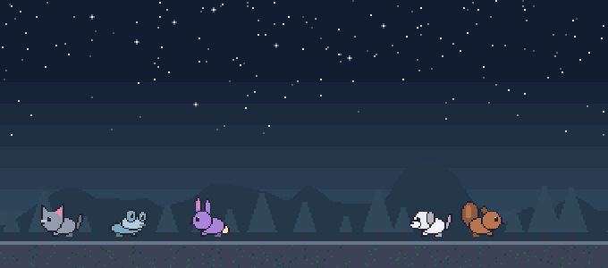

# Pets+

An editor pet that reacts to saves, commits, tests, and errors. Feed it, level it up, or take it along on a focus break. Pets+ runs locally and stays quiet.

## Install

1. Download the `pets-plus-*.vsix` from the [latest release](https://github.com/Yahlawat/pets-plus/releases/latest).
2. Open **Extensions → … → Install from VSIX…** in VS Code or Cursor and select the file. The same download works on macOS and Windows.
3. Open **Pets+** in Explorer. Click **+** or run **Pets+: Spawn Pet** to create your first pet.

### Bring over pets from VS Code Pets

Run **Pets+: Import from VS Code Pets** to copy names, colors, and species from the default desktop VS Code profile. The command works from VS Code or Cursor and opens the source database read-only. Install the [SQLite CLI](https://sqlite.org/download.html) and put `sqlite3` on your PATH if it isn't already there. Restart the editor after changing PATH. You can disable the original extension after importing. Pet names, stats, and history live in your editor profile.

## What they do

**React to your work** (turn off with `petsPlus.reactions`)
- Save: a hop.
- Git commit: confetti and a lap. Works for commits from Source Control and the terminal. Pulls and checkouts don't count.
- Tests: cheer when they pass, slump when they fail. Picks up test commands run in the integrated terminal (`pytest`, `npm test`, `go test`, `cargo test`, `make test`...) and tasks in the Test group. It can't see runs from the Testing sidebar, since VS Code doesn't share those with extensions.
- Errors going up in the file you're editing: they run to the edges. Clearing every error: relief.
- No activity for `petsPlus.idleMinutes` (10): they gather and nap. Typing wakes them. Fast typing gets them walking faster.

**Each species has its own ways** (`media/species.js`). About every 1 to 2 minutes a pet does something in character:
- Cats climb either wall, hang, drop and land on their feet. They groom, loaf, stare at nothing and get zoomies. They swipe at pets walking past and sometimes refuse petting. When errors appear they go up the wall, and they're often unimpressed by commits.
- Dogs sniff around, roll over and get zoomies. They chase cats and squirrels up the wall and bark at the bottom. They bring the ball back and drop it: click it to throw again.
- Foxes pounce like they're mousing, sometimes at another pet.
- Turtles are slow, hide in their shells and sunbathe. Drop one, or sometimes it scrambles, and it ends up on its back, wiggling. Click it to flip it over, or a friend comes to help after a while.
- Raccoons rummage and find things, wash their paws, and steal treats and the ball.
- Foxes and raccoons are night owls. After 8 pm local time they stay up while the others nap.
- Squirrels climb, dig into the wall, nap on it and stash acorns. Bunnies hop and binky, frogs leap and catch flies, ducks and chickens waddle, crabs walk sideways, rats scuttle, snakes slither, and snails leave a slime trail. Clippy and friends float.

**Care** (gentle)
- Food and mood drift down slowly: full to empty in about a day. Time away counts but is capped at 12 hours. Mood never drops below 10, and nobody leaves.
- Hungry pets ask for food and sad ones slow down and lose colour.
- Feed with the heart button (or `Pets+: Feed Pets`). Pets that are full say so.
- Click a pet to pet it. Drag one around and let go to drop it.

**Progression**
- XP: 1 per minute of typing, 2 per save (10 s cooldown), 15 per commit, 10 per passing test run, 25 per finished focus block. Every pet gets it.
- Level n to n+1 takes 60n XP, so level 2 is an hour of typing and level 10 is about 45 hours.
- Every 3 levels unlocks another colour of that pet. Pick it on the stats card.
- Streak: days with at least 15 minutes of typing, in a row.

**Stats card**: double-click a pet. Shows level, XP, mood, food, age, petted/fed counts, streak and today's minutes, plus Feed, Rename and Ball buttons and the colours you've unlocked.

**Focus timer**: the watch button (or `Pets+: Focus Timer`). 25 minutes of focus (`petsPlus.focusMinutes`), then 5 of break (`petsPlus.breakMinutes`). During focus the pets lie down and stop chatting. At the break they get up and nudge you. The status bar shows the countdown. Click it to stop or skip.

**Status bar pet**: your most recent pet (the last one you petted, fed or renamed), its mood and level, and 🍖 when hungry. Hover for all pets. Click to open the panel. Toggle with `petsPlus.statusBar` or `Pets+: Toggle Status Bar Pet`.

**Backgrounds** (`petsPlus.theme`, or `Pets+: Change Theme`). Each has a day look for light editor themes and a night look for dark ones:
- Classic settings: forest (stars at night), castle, beach (stars at night), winter (snow), autumn (falling leaves).
- More settings:
  - lakefront: Lake Michigan and the Grosse Point lighthouse. Gulls and sparkles on the water by day, a sweeping beam at night.
  - city: a skyline with two big towers. Clouds by day, lit windows switching on and off at night.
  - space: moon surface, a ringed planet, a flag. Twinkling stars and shooting stars.
  - dojo: BJJ mats, a belt rack (white to black), a shoji window. Dust in the light by day.
  - mountains: three ridges, snow caps, pines. Clouds by day, aurora at night.
  - room: wood floor, rug, bookshelf, plant. Rain on the window by day, stars and a lit lamp at night.
  - blossom: cherry trees and a torii gate, with petals falling.
- The moving bits can be turned off with `petsPlus.effects`. In a tall panel the scenery stays at the bottom and the sky or wall carries on above it.

More in the panel's `...` menu: stats, rename, theme, remove a pet, bring one back.

## Settings

| Setting | Default | |
| --- | --- | --- |
| `petsPlus.size` | `nano` | nano, small, medium, large |
| `petsPlus.theme` | `forest` | none, forest, castle, beach, winter, autumn, lakefront, city, space, dojo, mountains, room, blossom |
| `petsPlus.effects` | `true` | stars, snow, petals, rain, clouds, the lighthouse beam |
| `petsPlus.statusBar` | `true` | status bar pet |
| `petsPlus.reactions` | `true` | coding reactions (XP counts either way) |
| `petsPlus.idleMinutes` | `10` | nap after this long idle, 0 for never |
| `petsPlus.focusMinutes` | `25` | focus block length |
| `petsPlus.breakMinutes` | `5` | break length |

## Develop

`src/` contains the extension host and pet state. `media/` contains the webview, scenes, and sprites. `test/` contains unit and editor tests.

With Node.js 22 installed, run `npm ci`, `npm test`, and `npm run package`. Run `npm run test:install` after packaging to test a clean install in VS Code. On macOS, `bash test/run.sh` exercises feeding, progression, the focus timer, and Git reactions.

To preview the webview by itself, run `python3 -m http.server` at the repo root and open `http://localhost:8000/test/harness.html?theme=dojo`. The companion `test/scenes.html` previews the backgrounds.

## License and credits

Pets+ was inspired by [VS Code Pets](https://github.com/tonybaloney/vscode-pets). The sprites and backgrounds in this release are original pixel art. Regenerate the sprites with `uv run --with pillow==12.2.0 python scripts/draw-sprites.py`. The generator lives in `scripts/`. Source and artwork are available under the [MIT License](LICENSE).
